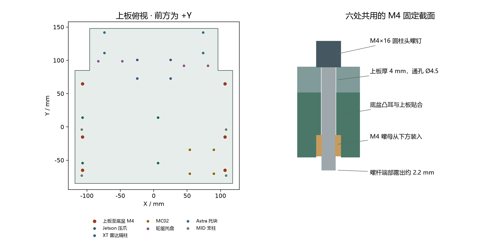

# Q8 R5 装配与运动审阅

打开 SolidWorks 文件夹中的 Q8R5_Q8_R5_整车.SLDASM。默认配置为 Motion。单独的 Q8R5_Q8_R5_姿态参考.SLDASM 提供可切换的五个参考姿态。HTML 可在本地浏览器独立打开。

## 上板如何固定

1. 首先将六枚普通 M4 六角螺母装入底盆凸耳下方的六角窝。上板落在六个凸耳顶面。
2. 从上方穿入六枚 M4×16 内六角圆柱头螺钉。上板厚 4 mm，孔径 4.5 mm，六角窝对边 7.3 mm、有效深度 3.4 mm。
3. 安装点 X = ±106.5 mm，Y = −65、−15、+65 mm。坐标原点在四髋中心，X 向右，Y 向前。六颗螺钉均可从上方拆卸。

## 设备的装配接口

| 部件 | 固定方式 |
|---|---|
| XT-M60 | Deck 的减重窗在承托面内收窄。四根 36 mm 双通 M3 隔柱从下方锁到 Deck，上端四枚 M3×8 固定鞍座。第二根柱的同心配合约束鞍座的转角。鞍座留有螺钉头避让和扎带槽。 |
| Jetson | 依据项目中的 NVIDIA Orin Nano 开发套件含底壳 CAD。四个打印压爪支承底壳、限制上抬，上板前后挡块约束纵向。每爪一枚 M3×22 和一枚下置 M3 螺母。左右爪同一零件旋转 180° 使用。 |
| MC02 | 原厂板四个 Ø2.4 通孔、四个 8 mm 隔套、四枚 M2×16 和 M2 螺母。装配体取两个真实板孔定位，保留 8 mm 隔高。 |
| 轮驱板 | 板卡绑在托盘上。托盘前侧外伸耳用两枚 M3×12 固定到上板，拧紧位置避开 PCB。 |
| 双 12 V 降压板 | 前后两块板各有挡边和穿带槽，共用的下舱托架由三枚 M3×12 穿底盆固定。 |
| Astra Pro Plus | 两个端部承托块各用两枚 M3×10 沉头螺钉固定。四个沉孔采用 90° 锥面。相机由托块、挡边和束带固定。 |
| MID360 选装 | 上板预留四个支柱孔，雷达底部的四个 M3 安装孔按原厂模型 36×48 mm 布局。 |

## 怎样审阅运动

在配置管理器中选择 Motion。设计行程为 −36° 至 +22°。两根 110 mm 连杆采用平行配合，轮架与基座保持平行。D 销与轮架孔的同轴偏差已逐姿态独立计算。展开四角中任一主动臂组件或直接单击臂的表面，使用“装配体 → 移动零部件 → 自由拖动”。拖动轮架能改变髋角，拖动轮胎还可能只转动车轮。
要查看某一对零件的距离，选择“移动零部件 → 动态间隙”。要看运动时何处接触，选择“碰撞检查 → 这些零部件”，选主动臂、从动臂、轮架、轮胎、机身或具体紧固件，勾选“碰撞时停止”。
使用“评估 → 干涉检查”可复查当前姿态。选择结果可高亮两个零件。全车螺纹建模使用名义圆柱，以下干涉有明确装配用途。
- 16 组 M5 髋座螺栓与其对应螺母。
- 装有 MID360 时额外 4 组 M3 螺钉与雷达厂商模型的螺纹底孔。

| 配置 | 工况 | 左前 / 右前 / 左后 / 右后髋角 |
|---|---|---|
| Motion_MID | 带 MID360 的独立拖动 | -7° / -7° / -7° / -7° |
| Motion | 四腿可独立拖动 | -7° / -7° / -7° / -7° |
| Ride | 巡航姿态 | -7° / -7° / -7° / -7° |
| Crouch | 下蹲 | -36° / -36° / -36° / -36° |
| Liftoff | 蹬伸终点 | 22° / 22° / 22° / 22° |
| FL_Raised | 左前腿单独缩回 | -36° / -7° / -7° / -7° |
| Diagonal | 对角异步极位 | -36° / 22° / 22° / -36° |

## 已核对的几何

- 19 个不同的自制打印零件文件有原生草图和拉伸或切除特征。上板有 90 个草图尺寸。沿用的 11 个轮腿打印件可打开轮廓草图修改，尚未逐一标注驱动尺寸。供应商几何及标准件简模在总装中单独出现。
- 顶层四个轮腿运动链共有 44 个有效连接配合。在 Motion 与 Motion_MID 中保留四条腿的独立拖动自由度。重开 2 个配置比较位姿。对四个主动臂分别在整车装配环境中用求解器驱动到 −36°、+22° 并回到 −7°。
- 33 处固定接口由输出的实体截面校核。孔芯最大侵入 0.000 mm³，取孔缘外 1.25 mm 的支承环，最低覆盖率 100.0%。
- 车身设备静态检查，超过 0.12 mm³ 的非螺纹重叠 0 组。逐处数据见《R5_配合检查.csv》。
- 髋角 −36° 至 +22°，每 1° 取一个姿态。单腿 74 个实例，跨运动组有 641 对轴向区段可能相交。超过 0.12 mm³ 的穿透 0 组。轮腿与车身检查记录 0 组。四个角使用左右镜像安装。
- 塔克 Ø100×35 名义轮胎用完整旋转圆柱包络检查，胎侧到最近轮架紧固件 S06 的名义间隙为 6.5 mm。轮胎接头轴向尺寸和软胎实际变形仍需实物核对。
- 六条固定线路重新绕行。固定线与零件的抽查步距 1 mm，端子所属模块的进出线 20 mm 单独处理。固定线与设备的间隙异常 0 组，修订机械件与固定/活动线的间隙异常 0 组，固定线之间的重叠 0 组。
- 固定线间最小名义间隙 0.35 mm，位于 W74 与 W30。活动线与固定线的最小抽样间隙 9.57 mm。

## 使用边界

自由拖动可超出设计工作角。上面的验证范围为 −36° 至 +22°。按离散角度检查名义刚体几何，实物打印偏差、软胎压缩、线束抖动及落地变形尚未经装车测量。束带和泡棉的夹紧由刚性定位配合表示。原厂整机模块保留供应商几何。Jetson 压爪以项目内含原装底壳的 Orin Nano 开发套件为基准。

零件树、依赖清单、干涉结果和各姿态的求解记录收在“校核”文件夹。

操作参考见 [SolidWorks 动态间隙](https://help.solidworks.com/2024/English/SolidWorks/sldworks/t_Dynamic_Clearance_SWassy.htm)。
